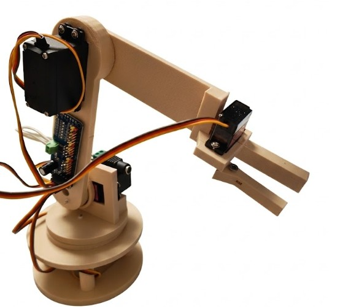
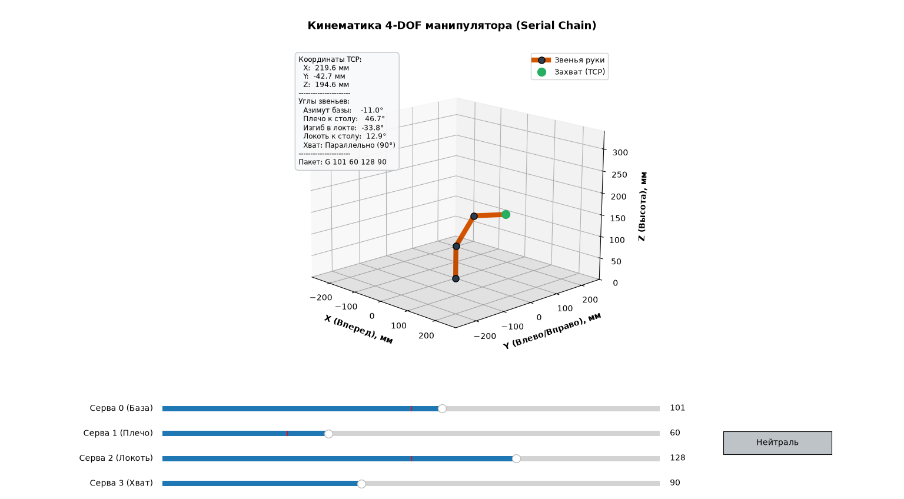

# 🦾 Simple 4-DOF ESP32 Robot Arm


> Настольный 4-осевой робот-манипулятор, полностью распечатанный на 3D-принтере. Проект построен на микроконтроллере **ESP32** и I2C-драйвере **PCA9685**, имеет крайне простую и доступную для повторения механику.

<p align="center">
  
  
</p>

## ✨ Особенности проекта
* **Простая сборка:** Минимум сложного крепежа — сборка осуществляется на саморезах, которые вкручиваются напрямую в пластик.
* **Детали:** Все детали спроектированы в КОМПАС-3D (готовые STL-файлы лежат в репозитории).
* **Одноактивный захват (1-DOF Gripper):** Рабочий орган использует схему с одной подвижной (активной) губкой, приводимой микросервоприводом SG90, что упрощает конструкцию, снижает массу на конце манипулятора и исключает лишние люфты в шарнирах.
* **Открытая кинематика:** В комплекте идет Python-скрипт с 3D-визуализацией кинематики для управления с ПК.

---

## 🛠 Комплектующие (BOM)

### Электроника
| Компонент | Кол-во | Примечание |
| :--- | :---: | :--- |
| **ESP32** | 1 | Основной контроллер |
| **PCA9685** | 1 | 16-канальный I2C ШИМ-контроллер |
| **MG996R** | 3 | Сервоприводы для базы, плеча и локтя |
| **SG90** | 1 | Микросервопривод для захвата (клешни) |
| **Блок питания** | 1 | Напряжение 3-12В, ток до 5А (питание сервоприводов) |
| **Разъем питания** | 1 | Гнездо-переходник DC 2.1 x 5.5 мм под БП |

### Крепеж и механика
Для сборки не нужны винты и гайки — всё собирается предельно просто:
* **Комплектные саморезы** от сервоприводов (используются для фиксации качалок и самих моторов в посадочных местах).
* **Около 10 дополнительных мелких саморезов** для стягивания остальных элементов конструкции.
* Распечатанные детали из папки `cad/stl/`.

---

## 💻 Программный стек

### 1. Прошивка ESP32 (ESP-IDF)
Прошивка принимает по UART (115200 бод) команды с углами вида `G 90 45 90 90` и транслирует их по шине I2C в драйвер PCA9685.
```bash
cd firmware
idf.py build flash


## ⚠️ Отказ от ответственности (Disclaimer)

Данный проект предоставляется «как есть» (as is). Автор не несет ответственности за любой материальный ущерб, поломку комплектующих, травмы или неудачные сборки, возникшие в процессе создания или использования данного манипулятора. Вы повторяете проект на свой страх и риск.

**Обратите внимание на габариты:** 
Все посадочные места в 3D-моделях проектировались и тестировались под конкретные экземпляры сервоприводов MG996R и SG90, которые были у меня на руках. Из-за огромного количества клонов от разных производителей, физические размеры ваших моторов могут отличаться.
